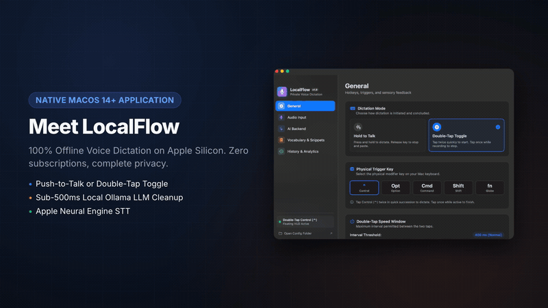
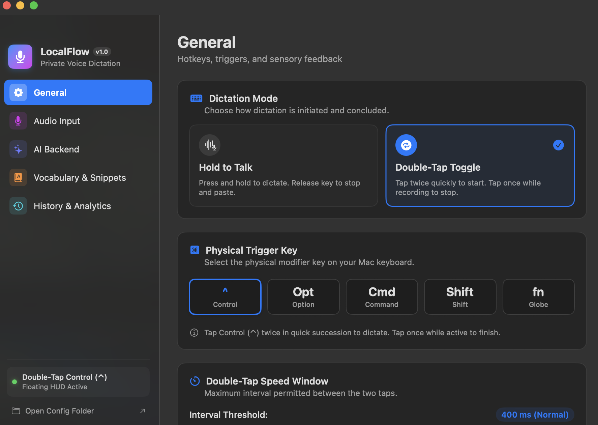
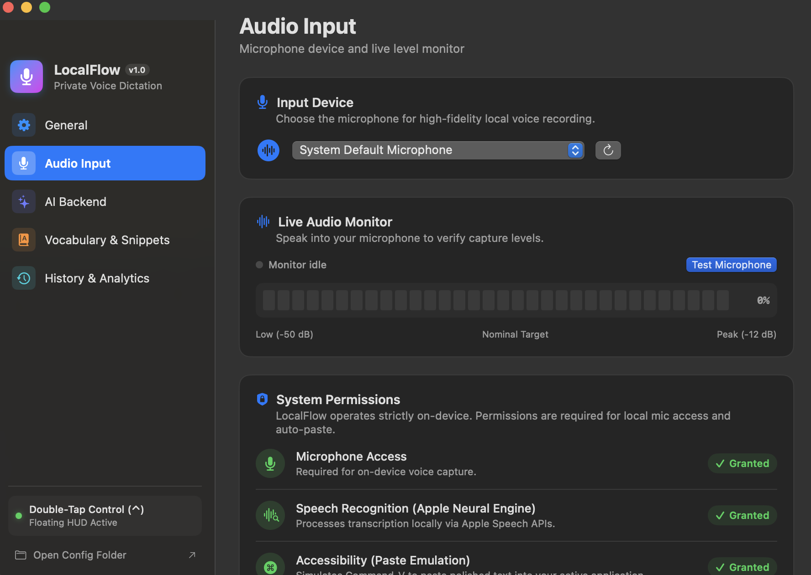
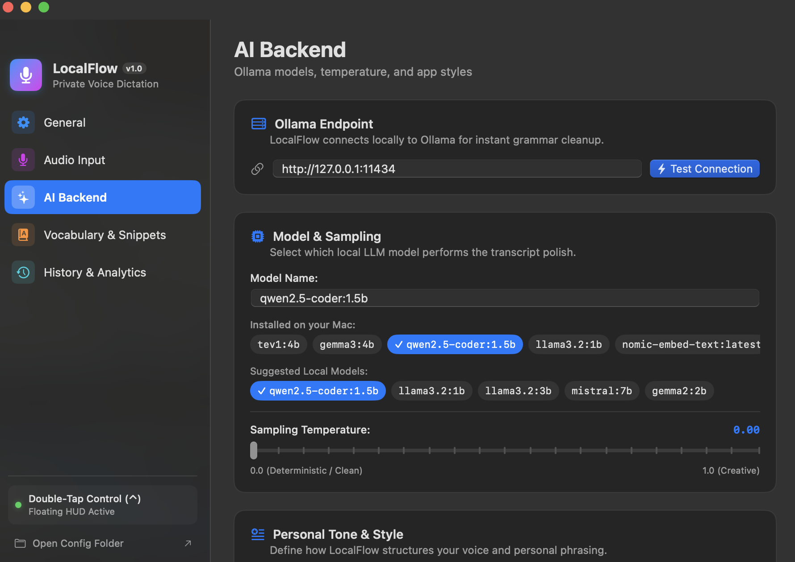
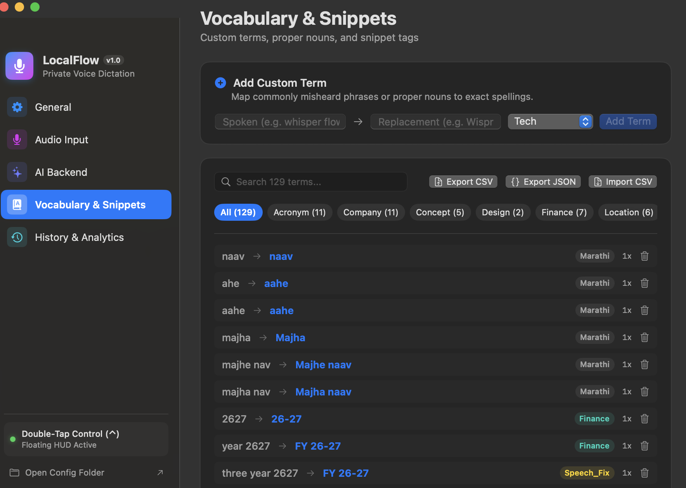
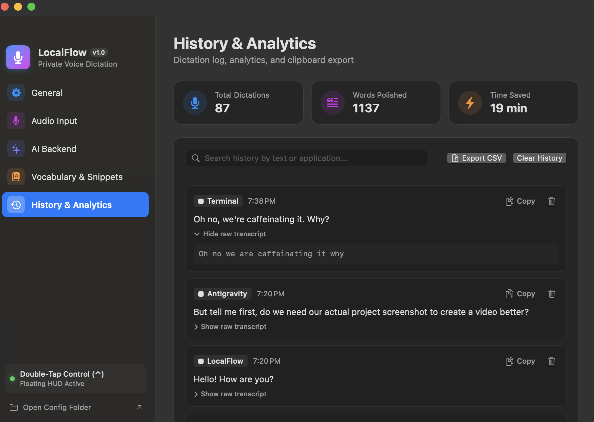

# LocalFlow

[](https://github.com/atish23/LocalFlow/actions/workflows/build-and-test.yml)
[](https://www.apple.com/macos/)
[](#)
[](https://swift.org)
[](https://opensource.org/licenses/MIT)
[](https://ollama.ai)

LocalFlow is a fast, 100% offline, native macOS voice dictation application built for builders, developers, and privacy-conscious professionals. It replaces cloud-based dictation tools (such as Wispr Flow) with a private, zero-subscription, local pipeline that runs directly on your machine.

---

## Launch Demo

<p align="center">
  
</p>

<p align="center">
  <em>LocalFlow in action: native speech recognition, live floating HUD, and local LLM formatting.</em><br />
  <a href="docs/images/localflow_demo.mp4">Download high-definition video (1080p MP4 with sound)</a>
</p>

---

## User Interface & Screenshots

LocalFlow features a native macOS configuration window built with SwiftUI and AppKit. It includes real-time audio meters, one-click Ollama model selectors, custom vocabulary management, and dictation history analytics:

### 1. General Settings
Configure Push-to-Talk (Hold-to-Talk) versus Double-Tap Toggle modes, choose physical trigger keys, adjust double-tap timing, and toggle trackpad haptics or audio cues.

<p align="center">
  
</p>

### 2. Audio Input & Live Level Monitor
Select active microphones, monitor live RMS audio levels in real time, and verify macOS privacy permissions (Microphone, Speech Recognition, and Accessibility).

<p align="center">
  
</p>

### 3. AI Backend (Local Ollama LLM)
Connect to local Ollama endpoints, auto-discover installed models (such as Qwen 2.5 Coder or Llama 3.2), tune sampling temperatures, and customize personal voice styling instructions.

<p align="center">
  
</p>

### 4. Vocabulary & Snippets
Add domain terms, technical acronyms, and phonetic corrections. Expand shorthand tags (such as `:standup` or `:email`) and import or export dictionaries via CSV and JSON.

<p align="center">
  
</p>

### 5. History & Analytics
Review past dictations, search by keyword or application, inspect raw versus polished transcripts, copy prior entries, and export your history to CSV.

<p align="center">
  
</p>

---

## Key Highlights

- **100% Private & On-Device**: Built on Apple Speech Framework (`SFSpeechRecognizer`) executing directly on the Apple Neural Engine (ANE). Your audio never leaves your computer.
- **Push-to-Talk & Double-Tap Modes**: Choose between Hold-to-Talk (press and hold key while speaking, release to paste) or Double-Tap Toggle (double-tap key to start, single-tap to finish).
- **Customizable Global Hotkeys**: Bind dictation triggers to Control (⌃), Option (⌥), Command (⌘), Shift (⇧), or Function/Globe (fn).
- **Tactile Trackpad Haptics & Audio Cues**: Experience subtle physical click feedback via `NSHapticFeedbackManager` on start, stop, and paste, alongside gentle audio cues.
- **High-Speed Local LLM Cleanup**: Connects to local [Ollama](https://ollama.ai) (`qwen2.5-coder:1.5b` or `llama3.2:1b`) to refine grammar, fix spelling, and remove duplicate stutter loops in under 500ms.
- **Resilient Deterministic Fallback**: If Ollama is offline or times out (>2.5s), LocalFlow immediately falls back to its deterministic regex pipeline. Your workflow is never blocked.
- **Custom Vocabulary & Phonetic Auto-Correct**: Pre-seeded with developer jargon, Indian names, finance terms, and tools. Add words through the UI or SQLite store (`~/.config/localflow/history.db`).
- **App-Aware Formatting**: Automatically tailors style to the active application:
  - **Code editors & terminals** (VS Code, Terminal): clean raw tokens without corporate filler.
  - **Email** (Apple Mail): formal capitalization and complete sentences.
  - **Chat** (Slack, Messages, Signal): natural, conversational phrasing.
- **Live RMS Waveform HUD & Zero-UI Headless Mode**: Floating glass pill displays real-time audio waveforms, or toggle Headless Mode for zero visual distraction.
- **Comprehensive SwiftUI Settings Window**: Manage audio devices, hotkeys, LLM models, vocabulary, and search/export history directly from the macOS Menu Bar.

---

## Architecture

```
                    +-----------------------------+
                    |    Microphone Audio Input   |
                    +--------------+--------------+
                                   |
                                   v
             +-------------------------------------------+
             |   Apple Neural Engine (ANE) Speech STT    |
             |       (SFSpeechRecognizer On-Device)      |
             +---------------------+---------------------+
                                   | Raw Transcript
                                   v
             +-------------------------------------------+
             |   Step 1: Deterministic Text Polisher     |
             |  - Filler words removal (um, uh, er, ah)  |
             |  - Mid-sentence self-correction resolver  |
             |  - Custom tags expansion (:standup, :gh)  |
             |  - Phonetic SQLite vocabulary mapping     |
             |  - Currency, fiscal years, lists format   |
             +---------------------+---------------------+
                                   | Formatted Text
                                   v
             +-------------------------------------------+
             |   Step 2: Local LLM Grammar Refinement    |
             |        (Ollama: Qwen 2.5 Coder 1.5B)      |
             |    * Instant 2.5s fallback to Step 1 *    |
             +---------------------+---------------------+
                                   | Polished Text
                                   v
             +-------------------------------------------+
             |   Step 3: Multi-Clause Loop Deduplication |
             |  (Eliminates pause stutter repetitions)   |
             +---------------------+---------------------+
                                   |
                  +----------------+----------------+
                  |                                 |
                  v                                 v
     +--------------------------+     +--------------------------+
     |   SQLite History Store   |     |   CGEvent HID Injection  |
     | (~/.config/localflow/db) |     | (Cmd+V into Frontmost)   |
     +--------------------------+     +--------------------------+
```

---

## Keyboard Shortcuts & Dictation Modes

Configure your preferred mode anytime via **Menu Bar > Settings & Preferences > General**:

| Mode | Trigger Key | Start Action | Stop & Paste Action |
| :--- | :--- | :--- | :--- |
| **Double-Tap Toggle** *(Default)* | Control (⌃) | Tap key twice within 400ms | Tap key once |
| **Hold-to-Talk (Push-to-Talk)** | Control (⌃) | Press and hold key down | Release key |
| **Custom Trigger Keys** | Option (⌥), Command (⌘), Shift (⇧), Function (fn) | Configurable | Configurable |

---

## Quick Start & Installation

### Option 1: Install Pre-Built DMG

1. Download the latest `LocalFlow-1.0.0.dmg` from the [Releases](https://github.com/atish23/LocalFlow/releases) page.
2. Open the DMG and drag **LocalFlow.app** into your **Applications** folder.
3. Launch LocalFlow from Applications.
4. When prompted, grant **Microphone**, **Speech Recognition**, and **Accessibility** permissions.

### Option 2: Build from Source

#### Prerequisites
- macOS 13.0 or higher
- Swift 5.9+ / Xcode Command Line Tools: `xcode-select --install`
- [Ollama](https://ollama.ai) (for local LLM cleanup):
  ```bash
  ollama run qwen2.5-coder:1.5b
  ```

#### Clone and Build
```bash
git clone https://github.com/atish23/LocalFlow.git
cd LocalFlow

# Run comprehensive test suite
swift test

# Build in release mode
swift build -c release

# Package standalone application bundle and DMG
./package.sh --dmg

# Or deploy directly to /Applications with persistent signing
./deploy.sh
```

---

## Configuration Reference

LocalFlow stores its configuration in `~/.config/localflow/config.json`. Changes can be made in the Settings UI or directly in the file (live-reloaded automatically):

```json
{
  "double_tap_threshold_ms": 400,
  "haptic_feedback": true,
  "headless": false,
  "hotkey_mode": "toggle",
  "llm_model": "qwen2.5-coder:1.5b",
  "llm_temperature": 0.0,
  "llm_url": "http://127.0.0.1:11434",
  "personal_dictionary": [
    "LocalFlow",
    "Wispr",
    "Kubernetes",
    "GraphQL",
    "Ollama"
  ],
  "sound_effects": true,
  "style_instructions": "Natural, direct, and conversational. Keep my personal tone, avoid unnecessary corporate filler, and format lists or numbers cleanly.",
  "tags": {
    ":email": "my.email@domain.com",
    ":standup": "Today I am focusing on"
  },
  "trigger_key": "control"
}
```

### Configuration Options

- `hotkey_mode`: `"toggle"` for double-tap toggle or `"push_to_talk"` for hold-to-talk.
- `trigger_key`: `"control"`, `"option"`, `"command"`, `"shift"`, or `"function"`.
- `double_tap_threshold_ms`: Duration (in milliseconds) within which two taps trigger dictation (default: `400`).
- `haptic_feedback`: Enables or disables Force Touch trackpad feedback (default: `true`).
- `sound_effects`: Enables or disables audio feedback chimes (default: `true`).
- `headless`: When `true`, hides the floating pill HUD and relies entirely on audio/haptic cues (default: `false`).
- `llm_url`: Base URL of your local Ollama server (default: `"http://127.0.0.1:11434"`).
- `llm_model`: Local model tag to use for refinement (default: `"qwen2.5-coder:1.5b"`).
- `tags`: Key-value map of shorthand phrases that expand automatically upon dictation.

---

## System Permissions Guide

LocalFlow requires three macOS permissions to operate properly:

1. **Microphone Access**: Captures live audio input for speech recognition.
   - *System Settings > Privacy & Security > Microphone > LocalFlow*
2. **Speech Recognition**: Enables Apple Neural Engine acoustic transcription.
   - *System Settings > Privacy & Security > Speech Recognition > LocalFlow*
3. **Accessibility**: Simulates paste keyboard events (`Cmd+V`) via HID tap to insert your dictated text into target applications.
   - *System Settings > Privacy & Security > Accessibility > LocalFlow*

You can verify and request all permissions at any time via **Menu Bar > Check System Permissions** or through the **Audio Input** tab in Settings.

---

## Packaging & Release Tooling

- `./package.sh`: Compiles in release mode and packages `LocalFlow.app` with icons and entitlements.
- `./package.sh --dmg`: Compiles, packages, and builds a distribution disk image at `build/LocalFlow-1.0.0.dmg`.
- `./deploy.sh`: Rebuilds, deploys to `/Applications/LocalFlow.app` with persistent development signing, and restarts the app.
- `./scripts/create_dmg.sh`: Standalone script to create compressed DMG with `/Applications` drag-and-drop link.
- `./scripts/notarize.sh`: Apple Notary Service submission and ticket stapling script.

---

## Running Unit Tests

LocalFlow includes automated unit tests covering regex polishing, SQLite persistence, vocabulary import/export, and configuration decoding:

```bash
swift test
```

---

## License

This project is licensed under the [MIT License](LICENSE).
